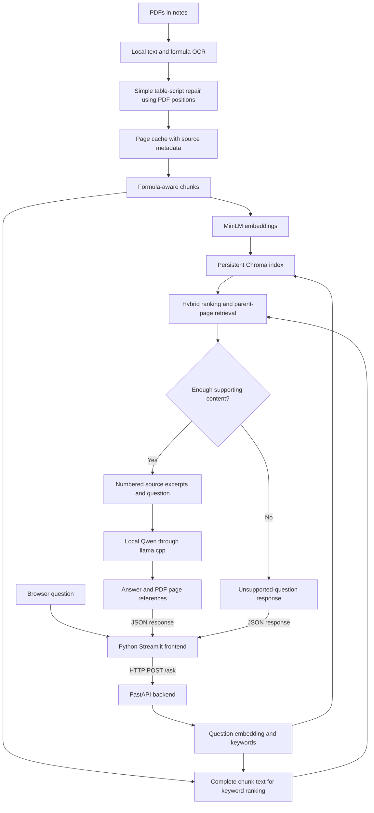

<!-- Purpose: explain the complete project in beginner-friendly English. -->
<!-- Work: document the architecture, files, local models, data flow, commands, and limitations. -->

# Numerical Analysis RAG Study Assistant

This project searches numerical analysis PDFs and generates explanations from the retrieved material. Answers include the original PDF filename and page references. The original collection contains eight PDFs, but additional PDFs and weeks can be indexed.

OCR, embeddings, vector storage, and answer generation run locally. Initial model downloads require internet access. Once setup and indexing are complete, questions do not require a paid answer API.

The original local index contains **8 PDFs, 109 pages, and 341 chunks**. The automated suite contains **32 tests**. The original retrieval/refusal evaluation passed **12/12 examples**. These results do not prove that every generated mathematical explanation is correct.

## 1. What is RAG?

RAG means **Retrieval-Augmented Generation**:

1. **Retrieval:** find passages related to the question.
2. **Augmentation:** include those passages in the answer model's prompt.
3. **Generation:** ask the model to explain the supplied material.

For example, a question about bisection retrieves relevant root-finding notes and provides them to the model. The model does not read the entire PDF collection for every question. The PDFs are indexed rather than used to train or fine-tune Qwen.

## 2. Original source material

| PDF | Pages | Main topics |
| --- | ---: | --- |
| Week 1 | 23 | Mathematical preliminaries and error analysis |
| Week 2 | 18 | Round-off and floating-point arithmetic |
| Week 3 | 15 | Divided differences and Newton interpolation |
| Week 4 | 13 | Newton forward/backward differences |
| Week 5 | 11 | Central difference formulas |
| Week 6 | 8 | Bisection, secant, and Newton-Raphson methods |
| Week 7 | 12 | Fixed-point iteration and systems |
| Week 8 | 9 | Jacobi and Gauss-Seidel methods |
| **Total** | **109** | **8 PDFs** |

References use one-based **PDF file page numbers**, which may differ from printed slide numbers. Original course PDFs remain local and are excluded from Git.

## 3. Complete data flow



The workflow has three stages:

- **Preparation:** extract text and formulas and cache the page results.
- **Indexing:** split pages into chunks, create embeddings, and save the search index.
- **Question answering:** retrieve saved evidence and generate an explanation.

OCR runs in a child process during ingestion. Exiting that process releases its model memory before embedding begins. Answering an indexed question does not rerun OCR.

## 4. Folder architecture

```text
RAG-NM/
|-- .github/workflows/tests.yml   GitHub Actions checks
|-- .streamlit/config.toml        Frontend port, theme, and telemetry settings
|-- api/
|   |-- __init__.py               API package marker
|   |-- main.py                   HTTP routes and shared model lifecycle
|   `-- schemas.py                Request and response contracts
|-- frontend/
|   |-- __init__.py               Frontend package marker
|   |-- app.py                    Streamlit interface
|   `-- api_client.py             HTTP calls to the backend
|-- src/rag_nm/
|   |-- __init__.py               RAG package marker
|   |-- config.py                 Shared paths and settings
|   |-- documents.py              PDF and page selection
|   |-- math_ocr.py               Formula OCR and page caching
|   |-- table_math.py             Simple table-script repair
|   |-- chunking.py               Formula-aware chunking
|   |-- embeddings.py             Local MiniLM encoder
|   |-- retrieval.py              Chroma, keyword ranking, and index storage
|   |-- library.py                Dynamic PDF and week discovery
|   |-- generation.py             Local model process and generation
|   `-- pipeline.py               Ingestion and answering coordination
|-- tests/                        Automated API, UI, OCR, and pipeline tests
|-- examples/questions.json       Original retrieval evaluation questions
|-- notes/README.md               Instructions for adding local input PDFs
|-- setup_models.py               Initial model/runtime downloads
|-- preview.py                    Extraction preview command
|-- ingest.py                     Index build/rebuild command
|-- ask.py                        Terminal question interface
|-- evaluate.py                   Real-data evaluation and demo generation
|-- requirements.txt              Full application direct dependencies
|-- requirements-ci.txt           Lightweight automated-test dependencies
|-- pyproject.toml                Package build metadata
|-- .env.example                  Optional settings template
|-- .gitignore                    Local and generated-file exclusions
|-- .gitattributes                Consistent text/binary handling
|-- README.md                     Quick start and API contract
|-- EXPLAIN_PROJECT.md            This detailed guide
|-- GITHUB_SETUP.md               First commit and publishing guide
|-- venv/                         Local Python environment; ignored
`-- data/                         Generated local files; ignored
    |-- models/ocr/               OCR model weights
    |-- models/embeddings/        MiniLM weights and tokenizer
    |-- models/answer/            Quantized Qwen GGUF weights
    |-- runtime/                  Windows llama.cpp runtime
    |-- extracted/                OCR JSON, Markdown, and artifacts
    |-- chroma/                   Persistent vector database
    |-- indexes/                  Chunk and parent-page records
    |-- index_manifest.json       Active successful index information
    |-- model_manifest.json       Downloaded model provenance
    |-- evaluation.json           Real retrieval/refusal metrics
    |-- formula_review.md         Local sample formula comparison
    `-- llm_server.log            Local model diagnostics
```

`notes/` contains inputs, `data/` contains generated outputs, and `venv/` contains installed libraries. Application code belongs in the project source folders rather than inside the virtual environment. `DEMO_OUTPUT.md` is generated locally by answer evaluation and is also ignored by Git.

## 5. Responsibilities of the main files

| File | Purpose and work |
| --- | --- |
| `config.py` | Resolve project paths and load optional settings. |
| `documents.py` | Validate PDF/page selection and return extracted page records. |
| `math_ocr.py` | Run CPU formula OCR and reuse valid cached results. |
| `table_math.py` | Restore simple scripts from original PDF glyph positions. |
| `chunking.py` | Create page-local chunks while preserving complete formulas and table headers. |
| `embeddings.py` | Load MiniLM and encode text into vectors. |
| `retrieval.py` | Store/search vectors, rank keywords, and retrieve parent pages. |
| `library.py` | Discover PDF filenames and optional week numbers. |
| `generation.py` | Manage llama.cpp, fit prompt context, and validate generated output. |
| `pipeline.py` | Coordinate ingestion and question answering. |
| `api/main.py` | Expose HTTP routes and manage shared generation resources. |
| `api/schemas.py` | Define API input/output validation. |
| `frontend/app.py` | Display the question form, answers, and references. |
| `frontend/api_client.py` | Send HTTP requests and translate API failures into readable errors. |
| `setup_models.py` | Download model artifacts and verify answer/runtime checksums. |
| `preview.py` | Inspect extracted text and formulas. |
| `ingest.py` | Prepare OCR and build the search index. |
| `ask.py` | Provide single-question, interactive, week-filtered, and retrieval-only modes. |
| `evaluate.py` | Measure original retrieval examples and optionally save real generated answers. |

Code comments explain each file's purpose and the work performed by important blocks.

## 6. Preserving mathematical formulas

Plain PDF extraction can flatten superscripts, separate fraction components, or lose script order. Local formula OCR represents equations as LaTeX:

- `x^{3}` represents a power.
- `\frac{a+b}{2}` represents a fraction.
- `x_{i}` represents a subscript.
- `x_i^{(k+1)}` includes a superscript iteration number.

For small table expressions, `table_math.py` checks original PDF glyph positions. Smaller text above or below the base letter can identify superscripts or subscripts. Repairs apply only to simple, unambiguous cells whose rows, columns, and headers match. Complex nested expressions are preserved for review rather than guessed.

Each page record retains its source:

```json
{
  "source": "Week_6_Numerical_Analysis.pdf",
  "page": 3,
  "text": "...text and LaTeX...",
  "extraction_method": "local_math_ocr",
  "review_required": true,
  "table_scripts_restored": 0
}
```

`review_required` is a reminder, not an accuracy score. Main formulas on three sample pages were compared with their originals. Extracting all 109 original pages does not prove that every formula was transcribed correctly.

## 7. Caching

OCR results are stored as JSON and Markdown under `data/extracted/`. The cache fingerprint includes PDF content, OCR package version, and cache schema/settings. Unchanged pages reuse their saved results. Changed content creates a new fingerprint; `--refresh` forces selected-page OCR.

MiniLM and the OCR engine also use in-process instance caching. Keyword-index data and parent pages are reused in memory. These in-memory caches end with the process; disk caches survive a restart. The frontend metadata cache and displayed-answer state are explained in section 17.

## 8. Chunks and embeddings

The system does not place the full PDF collection in every answer prompt. It uses page-local chunks with these rules:

- Target budget: 180 embedding tokens per chunk.
- Overlap budget: up to 25 tokens, retaining complete units.
- Inline/display equations remain intact.
- Tables are split into rows with repeated column headers.
- Each chunk retains its PDF filename, page number, title, part, and unique ID.

A long atomic equation can exceed the target and receives an `oversize_atomic` flag. Complete text remains stored. MiniLM can truncate its vector representation when its input limit is exceeded, while keyword search still reads the full stored text.

An embedding is a numerical vector used to compare text meaning. The same MiniLM encoder creates vectors for chunks and questions.

## 9. Retrieval

Retrieval combines two rankings:

1. **Semantic ranking:** compare the question embedding with Chroma vectors using cosine similarity.
2. **Keyword ranking:** use BM25-style scoring for relevant words.

Reciprocal rank fusion combines the rankings. Main numbered headings receive additional preference. Results are deduplicated by PDF page, with four distinct pages requested by default. Retrieval locates a small chunk and returns its complete parent page so surrounding explanations and equations can reach the answer model.

Only whole pages that fit the actual answer-model context budget are included. A support gate checks meaningful keyword support and minimum semantic similarity before generation. This is a heuristic, not a perfect topic detector. Clear standalone questions using English course terms work best.

## 10. Answer generation

The answer model is **Qwen2.5-1.5B-Instruct, Q4_K_M GGUF**, run on the CPU through **llama.cpp b11960**. The runtime binds to `127.0.0.1:8765`, with GPU offloading disabled.

The prompt contains system instructions, numbered PDF excerpts, and the question. The actual Qwen tokenizer checks the context budget. Pages that do not fit are skipped as complete units; equations are not cut halfway through.

The model returns structured JSON containing the answer and citation numbers. A JSON schema constrains citations to the supplied source range, and the application validates them. Exact formula matches after formatting normalization can supplement citations. This matching does not prove algebraic equivalence or mathematical correctness.

The application generates a local server access token in `data/local_server.key`. It is not a paid API account key. The server starts hidden, can be reused when compatible, and closes when its owning CLI/API session ends. The application does not terminate an unrelated server it did not start.

Model weights are saved on disk, but inference still needs RAM and CPU resources for weights, tokens, intermediate calculations, and temporary generation state. Saving a model as a pickle file would not remove those memory needs.

## 11. Local components and loading

| Component | Responsibility | Loaded when |
| --- | --- | --- |
| RapidDoc/formula OCR | Read PDF layout, tables, text, and formulas | New/changed page preparation |
| MiniLM | Create comparable search vectors | Indexing and question retrieval |
| Qwen | Generate an explanation from retrieved excerpts | A supported answer is requested |
| Chroma | Persist and search the vector index | Indexing or retrieval |

Model files and libraries are separate: `data/models/` stores weights, while `venv/` stores Python dependencies. Downloaded file size is not the complete runtime RAM requirement.

## 12. Setup and terminal commands

Run commands from the project root. Full interpreter paths make virtual-environment activation optional. For a new checkout:

```powershell
py -3.14 -m venv venv
.\venv\Scripts\python.exe -m pip install -r requirements.txt
.\venv\Scripts\python.exe -m pip install -e .
.\venv\Scripts\python.exe setup_models.py
.\venv\Scripts\python.exe ingest.py
```

Add your own PDFs to `notes/` before ingestion. The model setup currently targets Windows x64. After setup:

```powershell
.\venv\Scripts\python.exe ask.py 'Explain the bisection method and its midpoint formula.'
.\venv\Scripts\python.exe ask.py
.\venv\Scripts\python.exe ask.py 'Explain Gauss-Seidel' --week 8
.\venv\Scripts\python.exe ask.py 'What is relative error?' --json
.\venv\Scripts\python.exe ask.py 'What is the Jacobi update formula?' --retrieve-only
```

The interactive command accepts `exit` or `quit`. Questions are independent and do not include persistent conversation history. For extraction inspection:

```powershell
.\venv\Scripts\python.exe preview.py --pdf Week_8_Numerical_Analysis.pdf --page 3 --full
```

Add `--plain` to compare plain extraction. Plain preview is not silently substituted for corrected formula OCR during indexing. Use `ingest.py --rebuild` to rebuild vectors from cached pages, or `ingest.py --refresh-ocr` to recompute OCR as well.

## 13. Index rebuild safety

A rebuild creates a new collection. The active manifest switches only after all chunks are saved successfully. A failed build preserves the previous successful index.

Question-time checks compare PDF and embedding-weight fingerprints. Changed input is rejected with a rebuild message rather than answered using stale vectors. Previous successful collections are retained rather than automatically deleted.

## 14. Tests and real evaluation

```powershell
.\venv\Scripts\python.exe -B -m unittest discover -s tests -v
.\venv\Scripts\python.exe evaluate.py
.\venv\Scripts\python.exe evaluate.py --generate
```

Automated tests use controlled doubles for heavy models. They check API validation/output/errors, frontend HTTP requests and reruns, additional-week filtering, formula preservation, OCR cache invalidation, and failed-build rollback.

Real evaluation requires local PDFs, models, and an index. The original evaluation questions cover the original eight weeks. Retrieval results are saved in `data/evaluation.json`; generated answers are saved in `DEMO_OUTPUT.md` and `data/demo_results.json`. `data/formula_review.md` contains local sample comparisons. These generated files are ignored by Git.

A correct source hit and a correct generated explanation are separate measurements.

## 15. Limitations and troubleshooting

- The small answer model can make reasoning and arithmetic mistakes. Verify important formulas against original pages.
- OCR can misread inline text, merged tables, and unusual mathematical layouts.
- Empty OCR output raises an error rather than silently falling back to damaged text.
- The first OCR/index build can be slow; cached question answering does not repeat OCR.
- Missing model/runtime: run `setup_models.py`.
- Missing or stale index: run `ingest.py`.
- Port/startup failure: inspect `data/llm_server.log` and the optional `LLM_PORT` setting.
- Windows native-library errors may require the Visual C++ runtime. An Application Control block requires separate Windows policy diagnosis and is not resolved by installing a similarly named Python package.
- Development was verified on Windows x64, Python 3.14.5, and approximately 8 GB installed RAM. Close unnecessary applications during heavy local processing.

## 16. Provider documentation

- [RapidDoc](https://github.com/RapidAI/RapidDoc)
- [Sentence Transformers](https://www.sbert.net/docs/package_reference/sentence_transformer/SentenceTransformer.html)
- [Chroma Python client](https://docs.trychroma.com/reference/python/client)
- [Qwen model card](https://huggingface.co/Qwen/Qwen2.5-1.5B-Instruct-GGUF)
- [llama.cpp server](https://github.com/ggml-org/llama.cpp/tree/master/tools/server)
- [Streamlit](https://docs.streamlit.io/develop/api-reference)
- [FastAPI response models](https://fastapi.tiangolo.com/tutorial/response-model/)

## 17. Python frontend and API connection

The frontend uses **Streamlit/Python** and does not require Node.js or npm.

1. The browser opens Streamlit on `http://127.0.0.1:5173`.
2. `frontend/app.py` collects the question, optional week, and source-page limit.
3. `frontend/api_client.py` sends a Python HTTP POST to `http://127.0.0.1:8000/ask` with `question`, `week`, and `top_k`.
4. FastAPI validates the request and calls the existing `rag_nm.pipeline.ask()` function.
5. The pipeline performs retrieval and calls local Qwen on port 8765.
6. The API returns JSON; Streamlit displays the answer, LaTeX, and numbered PDF references.

The frontend uses the HTTP contract rather than importing the backend RAG function. Streamlit makes the backend request from its Python server, so this connection does not depend on browser CORS. Existing CORS settings support browser-based clients using the configured local origins.

`GET /library` provides current PDFs, optional week numbers, and index status without loading inference models. `GET /health` checks API liveness only. `/docs` provides interactive API documentation.

Library metadata is cached for 10 seconds. **Refresh library** clears that cache. The last displayed answer is stored in Streamlit session state to prevent duplicate POSTs during widget reruns. This display state is not conversational model memory or a generated-answer lookup cache; resetting the browser session can clear it.

Run the API and frontend in separate terminals:

```powershell
# Terminal 1: backend
.\venv\Scripts\python.exe -m uvicorn api.main:app --host 127.0.0.1 --port 8000 --workers 1

# Terminal 2: frontend
.\venv\Scripts\python.exe -m streamlit run frontend/app.py --server.port 5173 --server.address 127.0.0.1
```

Set an alternative backend URL before starting the frontend if needed:

```powershell
$env:RAG_API_URL='http://127.0.0.1:8000'
```

The API reuses its generator across requests and serializes RAG calls with a lock. Generation loads lazily on the first supported question and releases owned resources when the API stops.

## 18. Adding Week 9-16 or other PDFs

API validation, CLI options, and retrieval support positive week numbers without an eight-week upper limit. The catalogue discovers week filters from names such as `Week_9_Numerical_Analysis.pdf` and `Week_16_Numerical_Analysis.pdf`. Other PDF names remain searchable under **All notes**. Use unique filenames to preserve existing inputs.

1. Stop the API with `Ctrl+C` to release Qwen memory.
2. Copy new PDFs into `notes/`.
3. Run `python ingest.py` using the project environment.
4. Restart the API and click **Refresh library** in the frontend.

Unchanged pages reuse OCR caches; new/changed documents are processed. The complete vector index is rebuilt rather than updated by appending vectors only. Changing PDFs makes the old index stale; answering resumes after successful ingestion. Model retraining or re-downloading Qwen is not required.

More PDFs increase processing time, disk usage, and index size. The answer prompt still contains only selected pages within the context budget. Review extraction and retrieval quality on new topics; the original evaluation does not establish accuracy for additional weeks.

## 19. GitHub and fresh checkouts

The repository shares source and setup instructions, not the installed laptop environment. `.gitignore` excludes the virtual environment, model weights, extracted content, vector database, local settings/tokens, original PDFs, and generated reports. `notes/README.md` provides input instructions in a clone. Ignoring files does not delete their local copies.

A fresh checkout needs dependency installation and **`pip install -e .`** to make `src/rag_nm` importable. It also needs model setup, local PDFs, and ingestion. Direct application dependencies are pinned in `requirements.txt`; `requirements-ci.txt` contains the lighter test dependencies. The GitHub Actions workflow runs mocked tests on Windows/Python 3.14 without downloading inference models. Real evaluation is a separate local step.

`git add` stages files locally, `git commit` creates a local snapshot, and `git push` uploads commits to the remote repository. Publishing source does not host the running application.

Finish the first GitHub commit/push before adding Docker support in a separate commit. This preserves a working baseline and makes packaging changes easier to review. Docker is optional for the current local setup and has not been implemented yet.

See [GITHUB_SETUP.md](GITHUB_SETUP.md) for publishing commands. Repository visibility and the project distribution license remain owner decisions; no open-source license grant has been added automatically.
